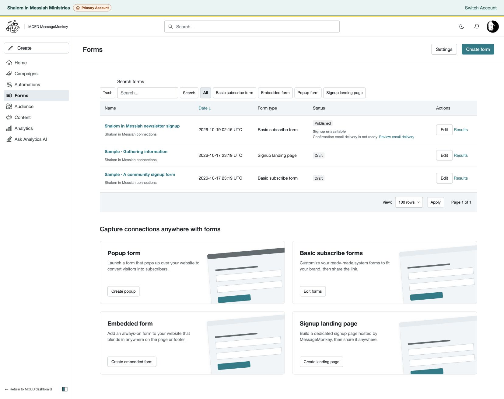
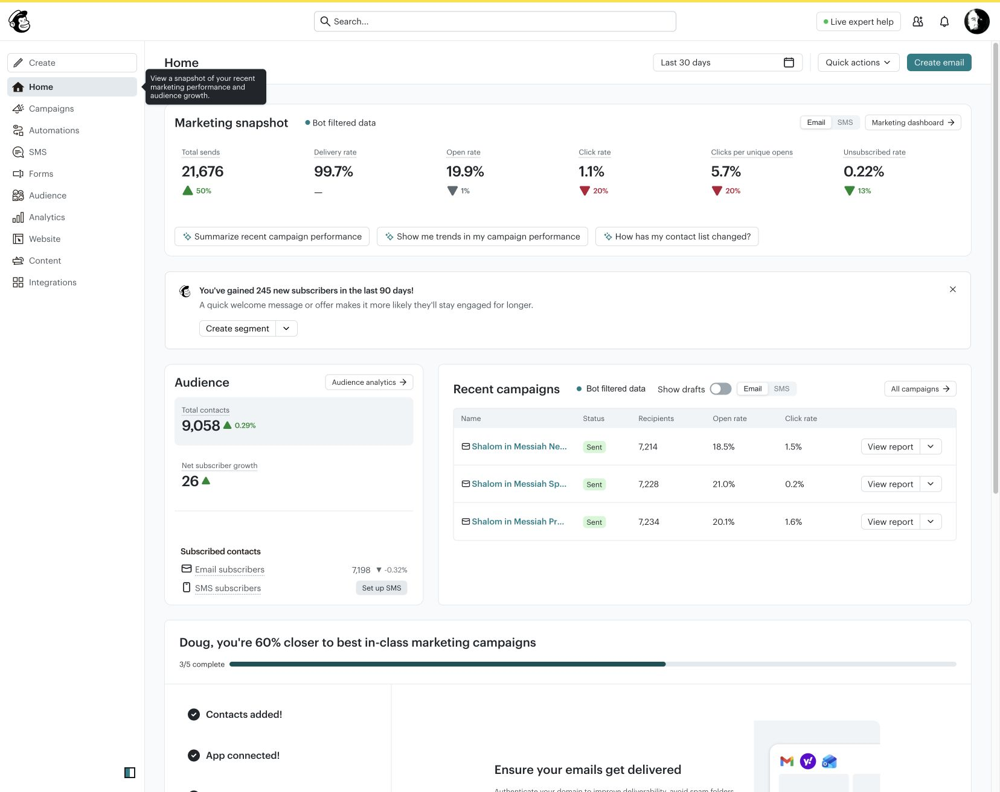
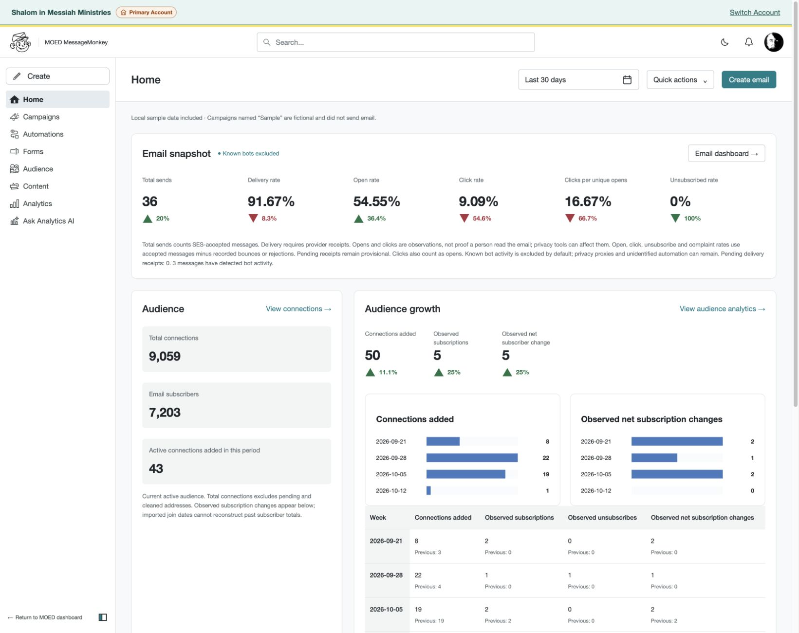
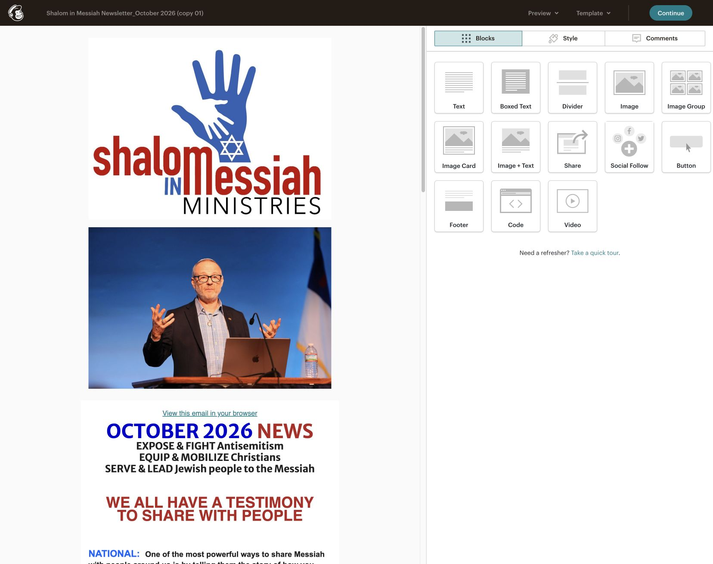
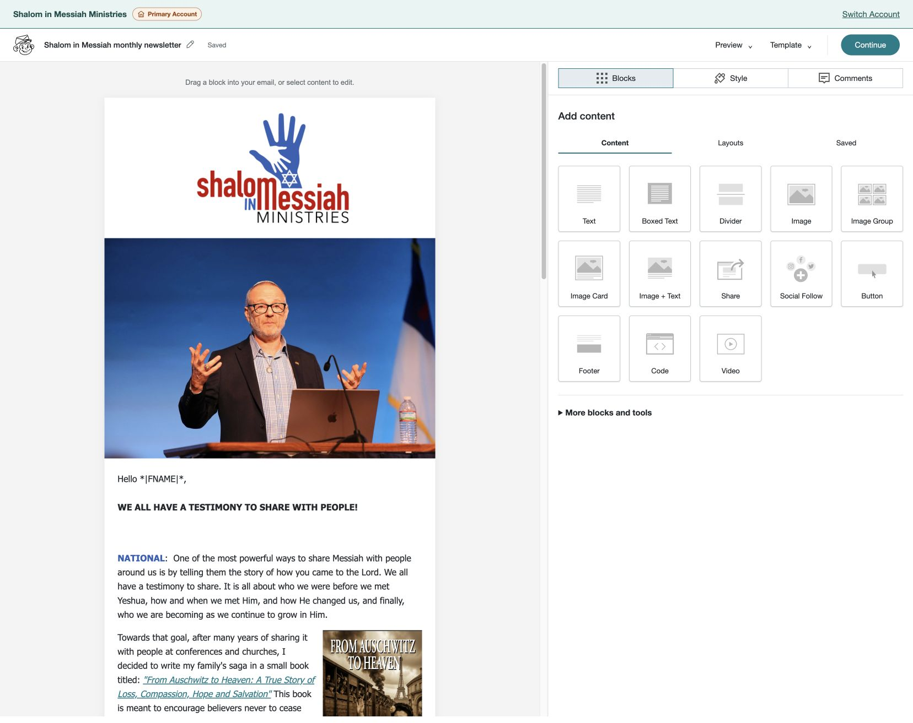
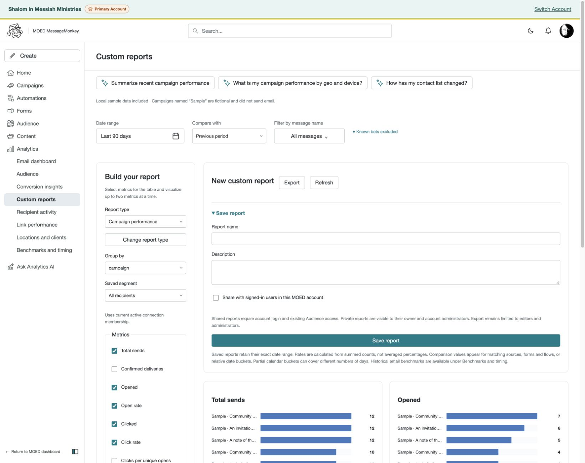

# MessageMonkey / Mailchimp quality-control review

Reviewed October 21, 2026, on `codex/subscription-preferences-polish`, using the signed-in Mailchimp account, localhost MessageMonkey, implementation inspection, and isolated regression tests.

**Verdict:** MessageMonkey is recognizably modeled on Mailchimp and covers most of the everyday newsletter workflow. The classic email editor and Inbox are the closest matches. Home, reporting, Content Studio, and Brand Kit have the same broad concepts but noticeably different density and control placement. It should be familiar to a classic-builder user, but it is not a drop-in replacement for every Mailchimp capability. Production has passed controlled live-delivery qualification; normal subscriber campaign sending remains separately gated.

The functional defects reproduced during this review were fixed locally. Remaining capability differences, operational prerequisites, and aesthetic recommendations are separated below. Existing exclusions were respected; this review did not reintroduce SMS, commerce, A/B testing, or external integrations.

## Functional defects corrected

| Priority | Reproduced problem | Correction and evidence |
|---|---|---|
| High | Save/preview accepted a design below 10 MB, but dispatch still rejected bodies above 6 MB. A valid 6,670,962-byte design reproduced the error. | Delivery now replaces embedded images with immutable hosted URLs before applying the shared 10 MB body limit, after tracking expansion. Review uses the same hosting assumption. A conflicting 9.5 MB encoded-message check in the SES worker was also removed; the shared 25 MB MIME safety limit remains. Synthetic image-heavy, oversized-message and 9.68 MB content transport tests cover these paths. |
| High | Uploaded GIFs appeared in the editor but remained data URLs in outgoing email; the delivery asset endpoint did not recognize GIF. | GIFs now follow PNG/JPEG/WebP through hosting. HTTP tests verify anonymous capability-based retrieval, exact bytes, and `image/gif`. Animation bytes are not re-encoded. |
| High | Pasted HTTP links were silently stripped. Bare domains and email addresses could become empty links pointing back to the editor. The checker lost unsupported links and merged multiple empty destinations into one. | HTTP destinations are retained; bare domains and email addresses normalize to HTTPS/mailto. Unsupported destinations remain identifiable as missing links without an active href. Each missing destination is reported. HTTP click tracking now uses signed redirects; server-side link probing remains restricted to public HTTPS. Browser, PHP, and HTTP regressions cover these paths. |
| Medium | The segment field chooser extended beyond the dialog and clipped the available options. | The chooser sizes to available dialog/viewport space and opens upward when appropriate. Browser verification showed its complete 320px menu inside the dialog, and keyboard search/selection reached “Email link clicked.” |
| Medium | A double-opt-in form could be labeled only “Published” while confirmation delivery was unavailable, preventing signup completion. | The forms list now also displays “Signup unavailable” and a delivery-setup link. This uses the published revision’s opt-in setting. It does not enable sending or alter subscription policy. |
| Medium | Designer preview resolved Brand Kit footer fields, while campaign checklist, team review, delivery preview, and template thumbnails showed raw company/address tags. | Those previews now resolve account identity consistently, with HTML escaping. Recipient merge fields and conditional content remain unpersonalized until a recipient context is supplied. Sent-delivery views use snapshot identity when available. |
| Low | Content, Brand Kit, and campaign pages used the generic “Campaigns” browser title; several audience tools used “Audience.” | Document titles now follow the actual page or campaign name, improving tab identification and accessibility. |
| Low | Campaign list said “Bot filtered data,” implying the broader Mailchimp filtering model. | It now says “Known bots excluded,” consistent with the native reporting controls and their actual scope. |

Implementation is concentrated in `audience_dispatch.php`, `audience_email_asset.php`, `audience_delivery_runtime.php`, `audience_track.php`, the design sanitizers, `audience.js`, the campaign/collection controllers, and their templates. Earlier requested editor/upload improvements already present in the working tree were preserved.

**Existing damaged content needs review:** the saved newsletter contained link labels such as `towardsmessiah.com` and `shalominmessiah.com` with empty destinations before these fixes. The code now prevents further silent loss and exposes missing destinations. It cannot reliably recover URLs already discarded from saved content. No existing newsletter wording or destinations were guessed or overwritten.

## Workflow and capability comparison

“Present” means observed in the interface and/or supported by the inspected implementation and listed qualification. It does not mean that every option was exercised against a real provider.

| Area | Mailchimp reference | MessageMonkey assessment |
|---|---|---|
| Navigation | Home, Campaigns, Automations, Forms, Audience, Analytics, Content; contextual subnavigation. | Core destinations are recognizable. “Connections” replaces “Contacts” intentionally. Analytics AI is also exposed as a separate main item. Extra MOED account and shell controls change vertical spacing. |
| Home | Compact campaign summary and audience cards; visual starter templates and guided suggestions. | Metrics and growth history are present, but large charts, tables, and explanatory copy push recent campaigns farther down. This is a hierarchy/density difference, not missing campaign data. |
| Campaign library | Search, status/type/folder/date filters, list/calendar, row actions, reports. | Broadly matched. Native sent rows have metrics/report links. Explicit UTC dates differ from the account-local presentation in Mailchimp. |
| Campaign setup | To, From, Subject, Send time, Content; preview/test; tracking and resend settings. | All major steps present. Native checklist remains inside the full workspace, while Mailchimp uses a more focused composition surface. Existing campaign designs are snapshots; changing a saved template does not automatically replace an older campaign draft. |
| Scheduling | Scheduled send, time-zone features, send-time optimization. | Specific scheduling, recipient-zone Timewarp, and optimization controls exist. Native optimization uses observed account click history with a minimum evidence threshold and a stated fallback. It is not Mailchimp’s proprietary model. [Mailchimp optimization](https://mailchimp.com/help/use-send-time-optimization/). |
| Classic email editor | Left canvas, right Blocks/Style/Comments, familiar content blocks, Preview/Template controls. | Strongest visual/workflow match. Text, image, image group/card, image+text, button, divider, social, footer, code, and video are represented; extra heading/spacer/TOC/section tools are available. |
| Text editing | Rich formatting, lists, links/images, styles, colors, alignment and undo. | Expanded toolbar, palette/custom color controls, preserved selections, inline image sizing/wrapping, and history are implemented. The disposable browser fixture passed 68 checks, including repeated formatting and sanitization. Native system eyedropper behavior was not requalified on every browser/OS. |
| Preview | Desktop/mobile and personalization; Mailchimp also exposes header information and additional preview services. | Desktop/mobile, dark simulation, connection search, live merge fields, and a link checker are present. Native preview is not a Gmail/Outlook rendering guarantee. Recipient selection is still required to validate conditional/personalized content. |
| Template library | Saved/recent templates, import/code, reusable designs. | Present, with HTML/ZIP import and revisions. Gallery layout and built-in collection differ. This pass compared the classic editor; equivalence to Mailchimp’s newer builder is not established. [Builder distinction](https://mailchimp.com/help/about-mailchimps-email-builders/). |
| Audience management | Contact table, statuses, tags/groups, segments, imports, profiles and activity. | Core tools and permissions are implemented. Search/import entry points are recognizable. The native importer accepts CSV/TXT/TSV/XLSX up to 20 MB and 50,000 rows; it is not a full Mailchimp account-history migration. |
| Segmentation | Nested filters, saved segments, campaign engagement and vendor-derived attributes. | Nested all/any groups, custom fields, tags/groups, status/date/source/activity, accepted/open/click conditions, negative conditions, campaign/link selection, and known-bot controls are present. Vendor-derived ratings and predictions are not equivalent. |
| Contact insights | Activity and engagement metrics, contact rating, inferred attributes. | Native lifetime/per-campaign evidence and activity are implemented and qualified in the preceding review. No native Mailchimp-equivalent star rating was found. Mailchimp ratings depend on engagement relative to sending frequency. [Contact ratings](https://mailchimp.com/help/about-contact-ratings/). |
| Automation flows | Trigger-based visual flows with conditions, waits, emails and audience actions. | Visual map, three entry triggers, up to 200 steps, delays/waits/conditions, audience actions and simple percentage routing are implemented. Native starter catalog is smaller. The reference account did not provide a populated modern flow for a complete editor-to-editor exercise. [Mailchimp flow capabilities](https://mailchimp.com/help/about-customer-journeys/). |
| Forms/preferences | Hosted, embedded, popup and landing-page acquisition; surveys and preferences. | Native creation/edit/preview/publish/results and preferences are present. Form authoring uses a more conventional full-page arrangement. A published double-opt-in form currently depends on qualifying outgoing confirmation mail. |
| Content Studio | Image library, upload, folders, filters and grid/list. | Upload/drop zones, folders, search, file sizes, alt text, links, crop/rotate and supported PDFs exist. Static image inputs up to 20 MB downsize to 1 MB; Brand Kit logos to 2 MB. Animation has separate preservation constraints. Native cards expose more metadata and are less thumbnail-dominant. |
| Brand Kit | Logos, font, colors, button styling. | Default/secondary logos, licensed font upload/fallback, colors, button styling, organization name/address and preview are implemented. The native page is longer and more form-oriented. New uploads replace existing logos on save. |
| Analytics | Engagement/delivery charts, campaign/date filters, segments, custom reports, AI. | Main metrics, prior-period comparison, filters, drilldowns, locations/clients, native benchmarks and custom report creation/export are present. Up to two chart metrics mirrors the inspected report builder. Native controls take more space. |
| Reporting semantics | Mailchimp bot/privacy filtering and vendor data definitions. | Known-bot filtering does not equal Mailchimp’s MPP-aware filtering. Native rates use accepted messages minus recorded failures, with pending receipts identified. Historical/current segment membership and date-range semantics must be understood before comparing exports. [Bot filtering](https://mailchimp.com/help/about-bot-activity/). |
| Inbox | Compose, Sources, Labels, To Do/Done/Trash/All, notifications and templates. | Very close information architecture. Native email replies, contact forms, surveys and direct messages are represented. Local sample conversations do not prove reception. Separate s1 evidence confirms authenticated receiving on October 20 and controlled outgoing delivery on October 21; localhost has separate, unconfigured settings. |
| Global search | Search across contacts, campaigns, pages/actions and help. | Native dialog returned appropriate import-page and quick-action results. It has matching category concepts and recent campaigns. Search behavior also passes isolated HTTP tests. |
| AI | Content assistance and analytics questions. | Native content/analytics surfaces and context-sensitive prompts are present. Native structured findings and permissions are regression-tested; provider answer quality was not benchmarked against Mailchimp’s AI during this pass. |

## Significant remaining differences and cutover prerequisites

1. **Controlled live transport passed on s1; normal campaign sending remains gated.** The October 20 receipt confirms authenticated incoming mail, correct thread filing and duplicate protection. The October 21 qualification records four human-confirmed inbox deliveries and correct display, actual Gmail SPF/DKIM/DMARC passes, signed provider events, and controlled tracking/unsubscribe/confirmation/suppression checks. A fresh read-only AWS check on October 21 at 11:45 a.m. Chicago time confirmed production access GRANTED and sending enabled. These results do not authorize ordinary subscriber campaigns or qualify their scheduled dispatch. Localhost’s unconfigured connection is a separate environment, not a production blocker.
2. **History does not come across merely because connections do.** The reference Mailchimp account has substantial historical campaigns and engagement. The native account has imported connections, native drafts, and clearly labeled sample activity. No complete campaign/engagement-history migration was observed. Existing re-engagement segments and comparisons must not silently treat imported connections as having native history. Retain access to historical Mailchimp reports or define a separate migration scope.
3. **External forms must be redirected deliberately.** Existing website/WordPress Mailchimp forms continue feeding Mailchimp until replaced or reconfigured. Native hosted/embed functionality is available, but installing it on the external website was not part of this review.
4. **Privacy and bot filtering differ.** Mailchimp’s inspected custom report explicitly excluded MPP opens. MessageMonkey detects known bot/scanner signatures and discloses that unidentified automation/privacy proxies can remain. Do not expect matching open rates from the two systems even with comparable campaigns. This is a documented analytical capability gap, not a defect solved by relabeling.
5. **Some non-excluded capabilities remain absent or approximate.** RSS/feed-driven emails were not found in native authoring/dispatch, and contact star ratings are not implemented. Mailchimp supports scheduled RSS updates and feed merge tags. These require deliberate native product work, with documented semantics and feed-fetch protections, rather than a cosmetic imitation. [RSS automation](https://mailchimp.com/help/share-your-blog-posts-with-mailchimp/).
6. **Rendering equivalence still has limits.** The user confirmed correct display of the four controlled production test emails. That does not qualify every newsletter design, image-wrapping combination, responsive layout or dark-mode client. The familiar classic editor is the reference for this comparison; native dark simulation does not replace received-client checks for final content.

These items are not presented as newly fixed. The operational items should precede a real-account cutover; the feature gaps should be prioritized according to actual user workflows.

## UI/UX fidelity recommendations — no aesthetic changes made

| Area | What feels familiar | Recommended improvement |
|---|---|---|
| Overall shell | Left navigation, teal primary actions, neutral cards, familiar labels. | Preserve MOED account identity, but reduce unnecessary vertical overhead and reconcile navigation order. |
| Home | Snapshot metrics and campaign entry points. | Put recent campaigns and a compact audience summary in the first screen; move detailed growth tables and technical explanations below them. |
| Designer | Canvas/sidebar proportions, block palette, region style tabs and top actions. | Retain this classic-builder structure. Explicitly document the supported builder reference rather than claiming parity with both Mailchimp builders. |
| Campaign checklist | Same five major steps. | Consider a focused composition layout and consistent action emphasis, so setup feels less like a settings page. |
| Reports | Familiar metrics, two plots, filters, export/save. | Replace long checkbox sections with compact grouped controls; keep definitions available as help without forcing them into every scan path. |
| Content Studio | Grid/list, folders, search and upload. | Give previews more visual weight and consolidate metadata/filter rows. Preserve the requested visible file sizes. |
| Brand Kit | Correct logo/font/color/button concepts. | Group related controls more tightly and use shorter sections/previews. Existing drag/drop upload and compact selects are useful improvements. |
| Form editor | Design/settings/share concepts are available. | Improve discoverability and consistent primary actions; keep publication state and actual signup readiness together. |
| Time and terminology | Core nouns are recognizable. | Make “Connections = Mailchimp Contacts” explicit in onboarding. Consider account-local dates with a clear time-zone indicator; preserve UTC for audit details. |

The app maintains a recognizable Mailchimp vocabulary and structure, but **the overall look-and-feel is not uniform yet**. The largest remaining visual issue is information hierarchy and control density, not isolated button spacing.

### Paired evidence

| Mailchimp | MessageMonkey |
|---|---|
|  |  |
|  |  |
|  |  |

Screenshots document layout and discoverability. Different content, scroll positions and data populations are not treated as functional defects.

## Intentional boundaries

The [existing feature matrix](audience-mailchimp-feature-matrix.csv) records intentional exclusions: SMS, A/B experiments, VIP, commerce/store-dependent functions and predictions, website/store/appointment building, advertising/retargeting, integration marketplace and connected publishing/media services, third-party trackers, external webhook/API integration UI, external Litmus previews, and Google reCAPTCHA configuration. Ordinary social links/cards, landing pages, native abuse controls and native analytics remain in scope. One audience per MOED account is intentional. Public downloadable-file sharing and saved-logo selectors were removed at the user’s request.

These omissions should be communicated to users coming from Mailchimp, but should not be silently rebuilt as “bugs.”

## Qualification and limitations

- Browser exploration covered Home, campaigns/checklist/scheduling, classic email design and preview, audience/segments/import entry, flows, forms, content/Brand Kit, analytics/custom reports, search, and Inbox/source setup.
- Functional verification: **86 PHP designer checks**, **27 dispatch checks**, **20 delivery-runtime checks**, **68 browser rich-text checks**, and **36 JavaScript tests** passed. Browser checks also verified segment menu bounds, keyboard selection, published-form readiness and resolved campaign footer identity.
- The final isolated Audience suite passed **1,037 HTTP checks**, including the two new preview-route assertions, plus delivery/ingestion privilege, signed-event, gateway and credential-rotation suites. The restricted SES worker also accepted the 9.68 MB content fixture through a disposable provider, exercising the former 9.5 MB MIME rejection.
- Provider interactions in the regression suite used disposable adapters. No marketing campaign was sent, no production deployment performed, and no sending gate enabled during the review phase.
- The review does not qualify every device/browser, every Mailchimp plan-specific feature, historical-data migration, live inbox placement, or third-party AI answer quality. The October 18 report contains earlier findings and fixes; this document reflects the current review and does not reclassify those fixed issues as open defects.

Recommended order: preserve the completed controlled delivery evidence; review missing newsletter destinations; make the historical-data and external-form cutover plan explicit; then address the prioritized UI hierarchy differences and any genuinely used capability gaps.

## Live-delivery follow-up — production evidence reconciled

The initial follow-up inspected localhost and found no SES connection and no receiving receipt. Those observations apply only to the local environment. They were incorrectly treated as production blockers before the user pointed to s1; no duplicate configuration is needed.

Production s1 (`192.168.1.150`) has separate, completed evidence. The requested test recipient matches the Gmail recipient in that evidence (verified by its stored address hash):

- **October 20:** authenticated incoming message processed into the correct account/thread; repeated processing did not create a duplicate. Email routing and campaign replies were connected.
- **October 21:** four controlled inboxes received test emails; the user confirmed all four displayed correctly. Actual Gmail headers passed SPF, DKIM and DMARC. Success/bounce/complaint simulator receipts were verified and processed. Controlled tracking, unsubscribe, confirmation and provider suppression checks subsequently passed.
- **Fresh read-only check, October 21 at 11:45 a.m. Chicago:** s1 release 2.6.14; AWS production access GRANTED, sending enabled, quota 50,000 recipients/day and 14/second. No email was sent or setting changed during this review’s status check.
- **Remaining boundary:** ordinary subscriber campaign approval and configured campaign budgets remain off. Scheduled business-campaign dispatch was explicitly not qualified by the controlled-test run. The four-inbox display result is not universal email-client rendering certification.

Operational evidence: `var/deployment/message-monkey-inbox-signup-2026-10-20.json` and `var/deployment/message-monkey-live-qualification-2026-10-21.json`. These local receipts contain detailed operational identifiers and are intentionally not copied wholesale into this tracked report. No redundant live email was sent by this review.

## Predeployment verification — October 21 follow-up

Completed the requested checks locally; s1 and its account configuration were not changed.

- Full PHP test suite passed. PHP lint and all PHPStan configurations passed. Refreshed the reviewed AI Coach footer source hashes, corrected the subscription email label/help association, and updated obsolete assertions that conflicted with intentional HTTP-link support and the editor's orange color swatches.
- Python verification passed: **130 tests, five skips**. Final frontend build, syntax checks and **349 JavaScript tests** passed.
- The isolated packaged-image Audience run passed **1,038 HTTP assertions** plus storage/import, restricted delivery/ingestion worker, signed-event, gateway and credential-rotation suites. It had no application or migration source bind mounts. Provider calls used disposable adapters; no external email was sent.
- Added and exercised import cases for normalized duplicate addresses, skip versus update, repeated rows, unmapped fields and intentionally blank mapped fields. Existing opt-out protections also passed.
- A roughly **9.7 MB** newsletter fixture saved, reopened and previewed with inline images, colors, wrapping and links retained. Content over 10 MB was rejected. The restricted provider fixture also exercised large-content sending without real recipients.
- Upload fixtures passed **36 browser checks** in Chromium and Firefox, including downsizing, PNG transparency, exact GIF preservation and oversized-animation rejection. Example reductions: 6.91 MB to 835.1 KB in Chromium and 17.97 MB to 926.9 KB in Firefox. Block insertion-space checks passed **15 assertions**.
- Analytics AI layout checks passed at **1440, 768 and 390 px**: independent history scrolling, footer in the prompt column, matched column bottoms and no horizontal overflow.
- The final local candidate includes the subsequent color-picker changes. **729 packaged source files** match the working tree exactly. Its rendered footer contains version **2.6.14**, timestamp **2026-10-21 06:40:27 CDT**, and base commit **628b70c**. See [candidate receipt](review-assets/message-monkey-2026-10-21/predeployment-image-receipt.json).

The image is a local verification build from the working tree; its commit metadata identifies the base commit, not a new release. The 1,038-assertion backend run preceded the final color-only frontend change; the rebuilt image's source comparison and final frontend/browser checks include that change. Final committed-source CI, restore-verified production backups, the user save window, deployment health checks and parity across active accounts remain release-time requirements. The running local development stack still uses its older image metadata; it was not restarted because another task has active local overrides.

## Color selection parity — follow-up requested during verification

Inspected the user's live Mailchimp classic email editor and Brand Kit without changing their colors or content:

- **Classic text editor:** compact eight-column swatch dropdown, Automatic, and More Colors. More Colors opens a single Select color dialog containing the same extended web-color/grayscale arrangement, selected hex value, Clear, OK and Cancel. MessageMonkey now uses this interaction instead of nesting hex, Apply, native picker and eyedropper controls in one dropdown.
- **Brand Kit and email style fields:** in-page saturation/brightness gradient, hue slider, hex field and current-color sample. Brand Kit tiles show their hex values. Selection updates the existing form/model values; no backend setting format changed.
- **Eyedropper:** shown only when the browser provides the direct EyeDropper API. Unsupported browsers omit it. There is no operating-system color-window fallback.
- Swatch selection or confirmation closes the control. Cancel preserves the prior text color. Saved text ranges survive custom-dialog focus changes; repeated selections and reuse of the same color are covered.

Verification: **72 rich-text browser checks and 16 Brand Kit color checks** passed in Chromium and native Safari. Both suites also passed at 390 px in Chromium. Actual gradient pointer selection updated the form value and closed the panel. The real Brand Kit page was inspected with its normal CSS/CSP, and the tile-spacing and hex-field layout conflicts found there were corrected. Unit coverage also verifies exact hex/HSV round trips and the observed extended-palette ordering. These checks do not claim that screen sampling itself was exercised on every platform.

Screenshots: [text palette](review-assets/message-monkey-2026-10-21/text-color-palette.png), [Brand Kit picker](review-assets/message-monkey-2026-10-21/brand-color-picker.png).
