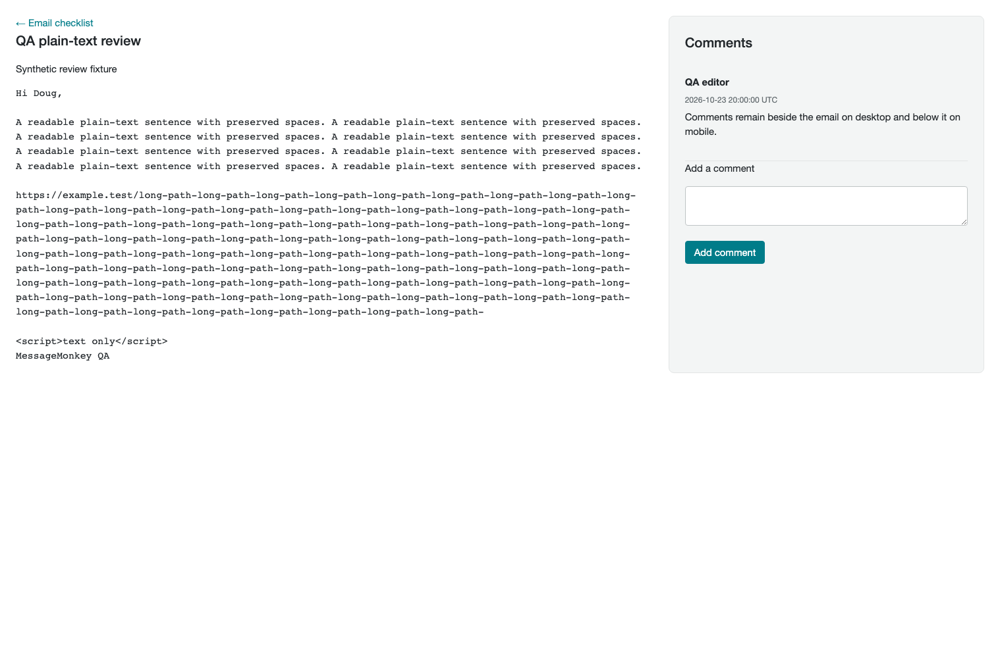

# MessageMonkey s1 functional qualification — October 23, 2026

**Result: not fully qualified.** Broad isolated regression coverage passed, and four live campaign test emails were delivered and confirmed received. Three production issues remain. Ordinary campaign dispatch and a real inbound reply were not qualified in this run.

## Scope and safeguards

- Deployed release: **2.7.0**, commit `82e99986bce98c13282453aaac3f53f8c3ad2867`.
- Working branch: `codex/messageMonkey-testing`, starting at `120468a`; includes notification-branding work from `codex/message-monkey-notification-branding`.
- Live account: Shalom in Messiah Ministries on s1. This is not a separate functional qualification of every production account.
- Outbound recipients were restricted to the four subscribed members of `testSegment` (segment 1). Membership was revalidated immediately before the campaign test send and independently audited afterward.
- No deployment, production code change, credential change, privilege grant, sending-policy override, or live automation activation was performed.
- Existing production connection subscription states were preserved. Destructive operations, imports, suppression, and permission matrices were exercised in a disposable environment instead of against business records.

## Production findings

### High: Inbox delivery fails before provider submission

Reproduction: compose a test message to a testSegment member, save a draft, satisfy normal Inbox readiness, and queue a reply from the test conversation.

The reply failed with **“Unable to prepare this message.”** Service-mail request 22 never started provider delivery. A read-only diagnostic inside the actual restricted mail-dispatch container reproduced MySQL error **1142** while reading `marketing_inbox_thread_labels` during recipient readiness. The application worker lacks a required SELECT privilege for this path.

Relevant implementation: `src/audience_inbox_runtime.php`, `src/audience_delivery_lifecycle.php`, and the canonical mail-worker grants. Avoid unnecessary UI-only queries and add a regression that invokes real Inbox recipient readiness with thread labels under the worker identity. Qualify the correction before applying it across accounts; do not bypass readiness or retry the failed message blindly.

### High: normal campaign dispatch remains approval/budget gated

The QA campaign reached all five completed checklist steps and exactly four eligible recipients. Send review remained disabled with **“Campaign sending is gated until delivery is approved and sending budgets are set.”**

The SES connection and quota check passed, but normal dispatch still requires `audienceMailPolicyReady()` (bulk approval and positive hourly/daily budgets). The SES interface exposes provider quotas without the legacy policy controls. The older delivery-policy form contains Proton-specific approval language.

Relevant implementation: `src/audience_delivery_setup.php`, `src/audience_mail_budget.php`, `src/audience_ses_worker.php`, and `src/templates/audience/delivery-runtime.php`. Use SES’s actual live quotas rather than the legacy SMTP approval/budget gate, then qualify ordinary campaign dispatch. Existing approval flags and budgets were deliberately not forced in the database.

### Medium: campaign recipient preview returns HTTP 404

On QA campaign 3, open To, select testSegment, and click Preview recipients. The interface displays **“Unable to read the operation status (HTTP 404). Reload the page to retry.”**

The backend recipient calculation independently returned four eligible contacts, zero outside testSegment, and automatic resend disabled. Browser submission in `src/assets/js/audience.js` uses `form.action` while the form contains an input named `action`; this is a likely route-resolution issue requiring a focused browser regression. The backend preview handler is present. No send relied on the broken preview result.

## SES and actual mail evidence

The initial SES readiness result was stale. After checking that pending delivery/setup queues were empty, the normal **Check connection** action refreshed it at 15:47 UTC. SES reported production access and sending enabled, a 50,000-recipient rolling daily quota, and 14 recipients/second. Inbox readiness then returned true with zero blockers. No AWS settings were changed.

Readiness checks expire after 15 minutes; a later review again displayed the freshness requirement. Refreshing readiness does not change AWS limits.

| Service-mail IDs | Path | Final result | Provider send started | Recipient restriction |
|---|---|---|---|---|
| 21 | Inbox draft | Cancelled by moving its conversation to Trash | No | In testSegment |
| 22 | Inbox reply | Failed during preparation | No | In testSegment |
| 23–26 | Campaign test email | Accepted; each has signed send and delivered events | Yes, four total | All in testSegment |

The user confirmed **all four test messages were received**. Real inbound reply routing and client-by-client visual rendering were not established by that receipt confirmation. No additional test emails were sent after confirmation.

## Coverage matrix

“Isolated” means exact deployed source with synthetic data and disposable delivery adapters, not a live production send or byte-for-byte qualification of the s1 runtime image.

| Area | Live s1 evidence | Isolated regression coverage |
|---|---|---|
| Navigation and account context | Authenticated screens, release footer, workspace search found QA campaign | Authorization, CSRF, account isolation, toolbar/search |
| Connections and segments | testSegment rules, four members, subscribed status, recipient scope | Profiles, tags, groups, fields, nested rules, concurrency, notes, management, counts |
| Imports/exports/jobs | Entry screens loaded; business data not bulk-mutated | Import wizard, duplicate/blank matrix, resumable jobs, exports, undo, deletion |
| Campaigns | Create from segment, From/subject/time/content save, 5/5 checklist, exact recipient calculation, test-email delivery | Completion, dispatch, tracking, suppression, retries, ambiguity/no-replay |
| Email design and content | AI-reviewed template saved; designer desktop/mobile canvas and link checks | Content/Brand Kit, template folders and bulk moves, permissions |
| Inbox | Empty landing/reload; unread toggle; mark unread; subject 700/400 weight; done/reopen; compose/template/draft; Trash cancellation and restore | Inbox HTTP/storage, source/template authorization, restricted ingestion and notification worker |
| Reusable replies | Create, archive, restore; delete unlock attribute and icon labels | Admin-unlock enforcement and counts |
| Forms | Unpublished embedded form created, title edited, saved/reloaded, archive/restore verified; left archived | Hosted/embedded/popup/landing collections, submissions and authorization |
| Surveys/preferences | Management screens loaded | Collection HTTP tests; live subscription changes not performed |
| Automations | Existing active flow inspected without alteration or activation | Authoring/execution separation and flow execution tests |
| Analytics | Dashboard, Last 7 days filter applied correctly, Analytics AI completed | Reports, recipient activity, native observations and analytics HTTP |
| Writing AI | Live synthetic prompt completed and reviewed template persisted | AI HTTP qualification |
| SES/security | Fresh readiness check and signed delivery receipts | Setup, signed-event verification, forged-envelope rejection, quota/throttle/rejection, credential rotation, restricted worker permissions |

The deployed-source disposable suite passed **1,282 Audience HTTP checks + 80 unlock/count checks + 196 pagination checks = 1,558 explicitly counted checks**, plus storage, worker, signed-event, credential-rotation and 18 gateway checks. Subsuite numbers within the 1,282 total are not additional counts. Its containers, networks and volumes were removed after successful completion. The production grant failure demonstrates why isolated passes alone do not establish s1 readiness.

Command: `python3 /tmp/mm-s1-2.7.0-qa/scripts/integration_environment.py audience`, using cached local runtime images and a `git archive` of the deployed commit. Detailed local output: `/tmp/mm-s1-2.7.0-regression.log`.

## Retained QA records and outstanding checks

- Campaign 3, **QA 2026-10-23 — testSegment delivery**: draft, not dispatched; retained to reproduce preview and policy blockers.
- Inbox thread 3: retained with cancelled/failed request history; existing thread 2 restored to its original read/To do state.
- Reusable reply 1 and email-design template 3: named QA fixtures retained for reproduction.
- Form 5, **QA 2026-10-23 — unpublished form**: archived; never published.
- Synthetic Writing AI and Analytics AI request results retained.

Next qualification requires fixing the three production findings, deploying through the normal shared release procedure, and repeating normal campaign dispatch and Inbox reply delivery solely to testSegment. A real reply from a test recipient is still needed for end-to-end inbound routing in this run. Public signup/opt-out mutations, live automation email execution, every email-client rendering variant, and every production role/browser combination were not exercised live; relevant synthetic suites passed, but these must not be reported as exhaustive live coverage.

Evidence screenshots: `review-assets/message-monkey-2026-10-23/recipient-preview-404.png` and `review-assets/message-monkey-2026-10-23/campaign-send-gate.png`.

## Fix and retest follow-up — October 23

All three corrections are implemented on `codex/messageMonkey-testing`. They are **not yet deployed to s1**, so the production findings above remain applicable to 2.7.0.

- **Inbox:** recipient eligibility now reads only thread identity and status, avoiding display-only label queries. Existing database privileges are unchanged. The new restricted-role regression prepares and delivers a labelled reply through the fake SES adapter, asserts that label SELECT remains forbidden, and rejects a missing conversation. Existing consent and Trash checks remain intact.
- **SES sending limits:** per the user's final direction, SES campaign review, dispatch, and automation readiness now use AWS production/sending status and live quota/rate checks. The proposed extra MessageMonkey budget form and enforcement were removed before release. Legacy SMTP allocation remains unchanged. Explicit campaign confirmation, current consent, connection checks, throttling, and no-replay protection remain enforced. No production quota or policy values were changed.
- **Recipient preview:** the browser uses the form's explicit action attribute or the current URL, preserving campaign query parameters despite a hidden field named `action`. The built bundle and asset manifest are updated. Browser checks passed with both omitted and explicit form actions, returning four synthetic eligible recipients and restoring the button state.

The earlier budget-based implementation passed its disposable suite, but was superseded before deployment. The final AWS-limits-only revision passed **1,281 Audience HTTP + 80 unlock/count + 196 pagination = 1,557 counted checks**, plus restricted worker, SES quota/throttle/no-replay, signed-event, gateway (18), and credential-rotation checks. `/tmp/mm-ses-live-limits-regression.log` exited 0 and the disposable environment was removed. Focused runtime (36) and SES validation (57) checks also passed. Browser verification of the preview fix used a localhost-only synthetic fixture with the real bundled JavaScript and no mail transport; a repeatable browser test is in `tests/browser/audience-recipient-preview.test.cjs`.

Two earlier disposable runs exposed errors in the new fixtures (an unverified synthetic sender could not link to a contact; a fake adapter returned a receipt ID instead of the required delivery state). Both fixtures were corrected before the successful complete run. These were not additional production failures.

**No real outbound email was sent during this fix/retest.** The next step is the normal shared patch release, followed by live verification using freshly resolved testSegment membership only. Do not replay failed/uncertain requests. Inspect pending queues and explicitly confirm the four-recipient campaign scope before any live send. No synthetic budget values should be applied to production. The branding branch is already an ancestor of the testing branch and remains included in the next release.

### Authorized patch qualification

The user authorized a patch deployment using actual SES limits and a live retest restricted to testSegment. Pre-release read-only checks found no queued/processing campaign recipients, service mail, or setup jobs. QA campaign 3 still targets four contacts, zero outside testSegment, with automatic resend disabled. Live retest results will be recorded after deployment.

Release preflight: both active accounts have empty MessageMonkey queues. The read-only network audit found 23 networks, 82 live IPv4 assignments, no collisions/overlaps, and all six static reservations outside dynamic pools. No schema or Comprehensive Guide changes; AI Coach source hashes match. Both requested branch tips are included.

## Consolidated qualification on 2.7.2 — October 23, 2026

This section supersedes earlier outstanding-check and deployed-version statements above. s1 is running **2.7.2 / 02e8591**. Earlier fixes were released through 2.7.1 and 2.7.2; the two fixes below are qualified together on `codex/plain-text-preview-fix` and **have not been deployed**. No intermediate release was made during this consolidated pass.

### Confirmed issues and combined fixes

1. **Plain-text campaign Preview returned HTTP 500.** Campaign 5 reproduced this on s1. Review comments incorrectly required a regular visual-design campaign. Review and comment ownership now supports plain-text campaigns while preserving draft-only comment mutations, audience/role authorization, and the plain-text visual-designer restriction. Ten added HTTP assertions cover rendering/escaping, comment persistence/resolution, reviewer permissions, CSRF, foreign audience, and sent-campaign immutability. Local browser Preview and comment save/reload passed.
2. **Idle SES readiness expired and disabled double-opt-in forms.** A published QA landing form was unavailable with a previously successful SES check older than 15 minutes; the normal Check connection action restored it. The existing worker only refreshed ready connections at send time, but blocked signup could not enqueue a send. The setup worker now refreshes enabled, previously ready connections after ten minutes, before their readiness window expires. Explicit queued checks take priority, the claim remains atomic and generation-scoped, and failed verification still blocks sending. Regression coverage under the actual restricted mail database role proves proactive idle refresh, no redundant fresh check, no email sent during refresh, and failure remaining blocked until an explicit check. No credentials, permissions, quotas, or database schema changed.

### Completed coverage

| Area | Live s1 evidence | Isolated qualification / scope limit |
|---|---|---|
| Campaigns and delivery | Four testSegment campaign deliveries received; Inbox delivery received; schedule/pause/resume/cancel; plain-text draft persistence and Preview defect reproduction | Combined HTTP/dispatch suite covers tracking, suppression, resend, retries, ambiguity, no replay and plain-text review correction |
| Inbound replies and attachments | Real campaign and Inbox replies routed into their exact conversations; user attachment imported once and downloaded with matching SHA-256 | Gateway checks cover signed routes, MIME, duplicate UID, unverified senders and automatic replies |
| Inbox and reusable replies | Read/unread, empty landing, draft/edit, done/reopen, Trash/restore, notes, attachments, templates and archive/restore | Authorization, permanent deletion unlock, notification and restricted ingestion checks |
| Imports, segments and reporting | Export job 6 contains exactly four testSegment rows; job 7 skips existing/duplicate rows and rejects one invalid row; copied segment narrowed to one member; reports, favorites, CSV and activity filters | Nested rules, concurrency, resumable jobs, isolation, undo and deletion |
| Public collection and consent | Embedded form validation, repeat signup without profile changes; approved beneliath@gmail.com unsubscribe → confirmation email → user confirmation → subscribed; landing report shows 1 submission, 1 confirmed opt-in, 100% conversion; archived public link becomes unavailable | Private preference-center saves, hidden-field preservation, invalid/expired tokens and collection authorization are isolated tests, not claimed as live recipient-preference edits |
| Surveys and popup forms | Survey publish/response/report and Questions desktop/mobile preview passed in earlier 2.7.2 retest. Popup draft origins, seven-second delay, page-prefix rules persist after reload; mobile preview works; fixture archived | Installed popup trigger/origin behavior and destructive lifecycle coverage use disposable fixtures |
| Campaign planning | Plan 1 created; task appears on calendar; marking Complete persists in Agenda and removes it from incomplete tasks | Date/order validation, ownership, replication and deletion exercised in HTTP suite |
| Designer and templates | QA template 4 duplicated/renamed; heading edited; prior version restored and verified after reload; comment added/resolved; desktop, mobile and simulated-dark preview render | Blocks, conditional content, revisions, permissions, folders and bulk operations covered by existing suites |
| Content and AI | Synthetic image upload, rename, alt text, folder move/filter/list; Brand Kit loaded; live Writing AI and Analytics AI synthetic requests completed | Content Trash was stopped at the normal Admin Unlock gate; destructive actions and role variants qualified in isolation |
| Automations and SES | TestSegment-only automation send delivered, then flow paused/archived; existing cleaned-contact housekeeping flow left unchanged; live SES readiness check and receipts | Execution/authoring privilege separation, live-quota adapter behavior, throttling, rejected/uncertain sends, signed SNS, secret rotation and worker grants |

This is bounded feature qualification, not a claim that every production role, third-party site, browser, or email client was exercised live. No production permanent deletion or Admin Unlock bypass was performed. An earlier unlocalized MutationObserver console error did not recur and produced no confirmed failed behavior; it is not included as a defect.

### Combined retest and outbound audit

- Canonical disposable run passed **1,291 Audience HTTP + 80 unlock/count + 196 pagination = 1,567 counted checks**, plus storage, SES setup/dispatch, restricted-worker, flow, notification, 18 gateway and credential-rotation checks. Subsuite totals are included in the 1,291 count. Exit status 0; temporary containers, volumes and network were removed. Log: `/tmp/mm-consolidated-regression.log`.
- Command: `DNR_TEST_APP_IMAGE=dnr-test-77e3e45ae8c8-app:latest DNR_TEST_INGRESS_IMAGE=dnr-test-77e3e45ae8c8-ingress:latest DNR_TEST_DATABASE_IMAGE=dnr-database:local python3 scripts/integration_environment.py audience`. Current source is mounted in an isolated database/runtime, and all automated email transports are fake. An initial sandbox invocation could not access Docker and executed no tests; the authorized Docker run passed.
- Live final audit: fresh testSegment resolution still returns four contacts; all four are subscribed and unarchived. The approved contact's original name, tags and groups remain unchanged. Service mail 29 is the accepted confirmation to beneliath@gmail.com; mail 30 is the accepted signup alert to doug@shalominmessiah.com. Both recipients match testSegment. No campaign recipient rows were created after ID 16. No pending service/campaign mail, pending Inbox alert, or active flow run remains. Read-only evidence: `/tmp/mm-s1-batch-final-audit.json`.
- QA forms 7, 8 and 9 are archived/paused. Retained fixtures include the completed planning task, QA template 4, unsent plain-text campaign 5, earlier synthetic content/report fixtures and the real inbound QA thread. They are not scheduled for delivery.

The next release can include both fixes in one normal shared patch. Post-release checks should verify plain-text Preview and idle readiness on the deployed version, preserving account release parity and restricting any outbound test email to freshly resolved testSegment membership.


## Remaining-gap pass on deployed 2.7.3 — October 23, 2026

Tested against s1 release **2.7.3 / bedfa7a61743b213a43291cd6ec211ce81651440**. QA branch: `codex/message-monkey-gap-qa`, in its own checkout. No application fixes or deployment were made in this pass; no confirmed product defect was found.

- **Real recipient preferences and unsubscribe:** used the actual private links retained for accepted QA campaign 3 / testSegment contact beneliath@gmail.com. Saved America/Chicago, checked persistence, and restored the original empty/Not set time zone. The real unsubscribe confirmation changed the recipient to Unsubscribed. The preference page continued to show Unsubscribed and offered a separate confirmation request, rather than subscribing during profile save. User completed the new confirmation email; contact 10885 is again Subscribed and unarchived, with original name, empty time zone, no tags and no groups. No other subscription changed. The delivered message's web view also rendered its personalized text, organization identity and subscription links.
- **Live content lifecycle and Admin Unlock:** the normal gate blocked moving synthetic asset 7 to Trash until the user completed password/MFA. Trash, restore and active-library rediscovery passed. After another move to Trash, the final permanent-deletion dialog identified exactly one selected QA file; the user explicitly approved deletion at that step. The 78-byte teal QA image was permanently deleted, and a read-only database audit confirms no library row 7 remains. Business images were untouched. Administrator actions were relocked after testing.
- **Live persisted delay/pause/resume:** flow 3 `QA 2.7.3 — timing and pause persistence` has only a two-minute delay and Exit flow, with manual entry. Enrolled only testSegment contact 10886. Run 2 was armed at 21:43:34 UTC with due time 21:45:34, then paused. At 21:45:45 UTC it was still active at its original delay node/due time. After normal resume, both steps completed once at 21:46:04 UTC and the run exited. The report showed Started 1, In progress 0, Exited 1, Needs attention 0. Flow 3 was then archived. This demonstrates elapsed-delay persistence, not a multi-day soak or production-worker restart test.
- **Popup rules:** added repeatable JavaScript tests for allowed origins, path exclusions, desktop/mobile rules, exact delay, one popup only, focus and sandbox, close/dismissal persistence, frequency boundary, exit intent, scroll threshold, and blocked browser storage. Ten popup/embed checks passed. These execute the deployed-version source in an isolated DOM fixture; no external website installation is claimed.
- **Scheduling boundaries:** nine new focused checks passed for Chicago/New York fall-back ambiguity, Chicago spring-forward gaps, valid times around the transition, half-hour offsets and UTC date rollover. The existing dispatch validation (29) and SES signature/API semantics (57) checks also passed. No campaign was dispatched or system clock changed.
- **Role/deletion browser coverage:** the existing synthetic lifecycle browser suite passed 56 checks covering admin/editor/reviewer visibility, responsive and light/dark layouts, archive/restore/deletion, confirmation reset and unlock expiry. This supplements the live admin test, not a live editor/reviewer sign-in. The active primary editor is `omelnick`; the primary reviewer `dnewberry` is inactive. Neither user's credentials or access was changed.

The isolated checkout initially lacked Composer dependencies; focused PHP tests could not start there. Reusing the workspace's installed dependencies allowed the successful checks above. This was a local test-environment problem, not a deployed application failure.

### Outbound scope and pending live evidence

Only two new service-mail records were created: confirmation 31 to beneliath@gmail.com and signup alert 32 to doug@shalominmessiah.com. Both were accepted and matched a fresh testSegment resolution. No campaign recipient rows were created after 16, and pending campaign/service queues are empty. TestSegment remains four subscribed contacts. The final scoped audit is `/tmp/mm-gap-final-audit.json`.

Human/external access is still required for an actual HTTPS website popup installation, editor/reviewer/demo sign-ins, and Gmail/Proton/Outlook/Apple Mail/mobile rendering observations. Requests for the installation target, existing editor sign-in and rendering observations are pending. Do not enable an inactive real reviewer or impersonate a user to fill the role matrix. Multi-day soak/DST passage and actual SES outages/throttles/bounces/complaints are not claimed as live tests. SES simulator addresses are outside the approved segment; do not add them to testSegment or broaden the allowed audience to manufacture those failures. Existing isolated provider-failure coverage remains applicable.

No confirmed fixes are waiting for deployment. Any subsequent findings should be batched on this QA branch and qualified together before requesting a release.

## Live editor pass and Preview layout correction — October 23, 2026

This follow-up supersedes the pending editor sign-in and no-pending-fixes statements immediately above. The user signed into the existing active `beneliath` editor account, then restored the normal `dgilmore` administrator session after testing. No user was created, reactivated or granted additional access by this test. s1 remains **2.7.3 / bedfa7a**; the one new correction below is qualified locally on `codex/message-monkey-gap-qa` and **is not deployed**.

### Live editor results

- **Campaign authoring and review:** created campaign 6 `QA 2.7.3 — editor role and scheduling`, a plain-text draft targeting the previously narrowed one-member test segment. The normal recipient control showed one eligible recipient, doug@shalominmessiah.com. Subject, preview text and body persisted after save/reload; Preview and an editor-authored comment persisted. The campaign was archived after testing and was never scheduled or dispatched.
- **Scheduling validation:** a saved draft may contain Chicago's repeated November 1, 2026 01:30 local hour, but Send review correctly rejected that ambiguous time and disabled Schedule. Changing it to 02:30 produced the correct 08:30 UTC review and enabled Schedule. No Schedule action was submitted; the final database audit found zero delivery records for campaign 6.
- **Private Inbox drafts:** the editor initially saw zero drafts, rather than the administrator's two. Opening administrator draft 1 directly returned “This draft is unavailable for your account.” Saved editor draft 5 to testSegment contact 10886 remains private, in Draft state, with no service-mail reference. It was not sent.
- **Form lifecycle:** restored archived QA popup form 9, changed its delay from seven to eight seconds and verified save/reload, then restored seven seconds. Normal publication and archive both passed. The final audit confirms the form is paused/archived with the original seven-second delay; no public signup was submitted.
- **Administrator restrictions:** the editor had no Admin Unlock control or permanent-delete controls in the inspected tag/segment, archived form and Content Trash interfaces. Brand Kit Save was disabled. Direct navigation to Email delivery was denied with “Email delivery requires an administrator.” These are live interface checks; earlier isolated authorization tests provide the direct mutation/role matrix. No administrator gate or credential was bypassed.

### Confirmed issue, fix and bounded retest

**Long plain-text Preview lines overlapped the comments pane.** In the live campaign 6 Preview at 1,518px viewport width, the `<pre>` pane was 788px wide with 980px of overflowing content and `white-space: pre`. The sentence continued beneath the comments panel. Before-fix evidence: `review-assets/message-monkey-2026-10-23/gap-editor-preview-overflow.png`.

The shared review CSS now uses `white-space: pre-wrap` and `overflow-wrap: anywhere`, retaining explicit line breaks and literal escaped text while containing paragraphs and long URLs within the preview pane. Rebuilt only the affected Audience CSS bundle and its manifest hashes. The change does not alter the email body or delivery behavior.

- New real-template/real-bundle browser fixture passed **20 assertions** at 390, 768, 1,518 and 1,920px: text and long URLs stay inside the pane, no horizontal page overflow, visible glyphs do not extend beneath Comments, newlines/literal markup are preserved, and Comments stack below the preview on mobile. The unchanged CSS first failed this fixture's overflow assertion; the corrected CSS passed. All browser requests are intercepted locally and external requests are blocked; no production records or transport are used.
- Existing lifecycle browser suite passed **56 assertions** after the shared CSS rebuild, covering responsive light/dark layouts, admin/editor/reviewer controls, archive/restore/delete confirmation and unlock expiry. PHP fixture lint, JavaScript syntax and `git diff --check` passed.
- Initial local fixture setup needed the workspace's installed Composer dependencies and its `audienceInputs` rendering helper. The sandbox blocked headless Chromium startup until the isolated browser run was authorized outside it. A whole-text Range also included hanging trailing spaces; the final geometry assertion measures visible glyphs. These were fixture/environment corrections, not additional product defects.

Repeatable check, with Playwright installed and its browser available:

```sh
node tests/browser/audience-campaign-review.test.cjs
```

`DNR_PLAYWRIGHT_MODULE` and `PLAYWRIGHT_BROWSERS_PATH` may select the existing local runtime; optional `DNR_REVIEW_OUTPUT` saves desktop/mobile screenshots. After-fix evidence: `review-assets/message-monkey-2026-10-23/gap-preview-wrapped.png` and `gap-preview-wrapped-mobile.png` (isolated fixture, not a deployed screenshot).

### Outbound audit and remaining limits

Fresh testSegment resolution returned four subscribed, unarchived contacts. No email was requested or created during this editor pass: service-mail maximum ID stayed **33**, its preflight value, and campaign-recipient maximum ID stayed **16**. Existing service mail 33 is an accepted audience alert whose recipient is in testSegment. Pending service mail, campaign recipients, Inbox email alerts and active flow runs are all zero. Campaign 6 has no delivery records, draft 5 has no service-mail ID, and form 9 is archived. Read-only audit: `/tmp/mm-gap-editor-final-audit.json`.

**One confirmed fix is now waiting for the combined release:** plain-text Preview wrapping. All available editor checks are complete. Actual external HTTPS popup installation still needs an authorized website target; existing reviewer/demo sign-ins and human email-client rendering observations remain unverified live. Multi-day soak, a real DST transition and deliberate SES outages/throttles/bounces/complaints remain isolated/simulated coverage, not live claims. No inactive reviewer was enabled and the outbound allowlist was not broadened.


